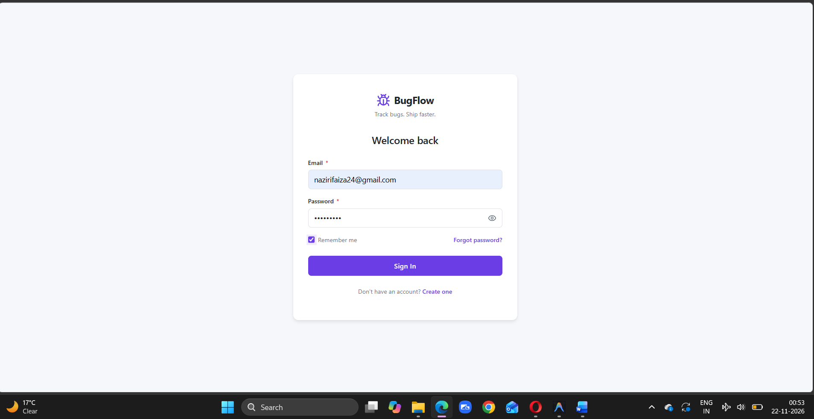
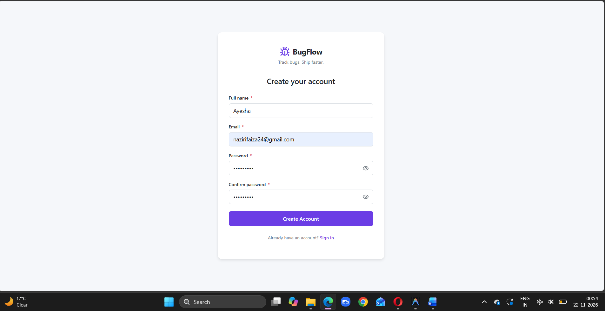
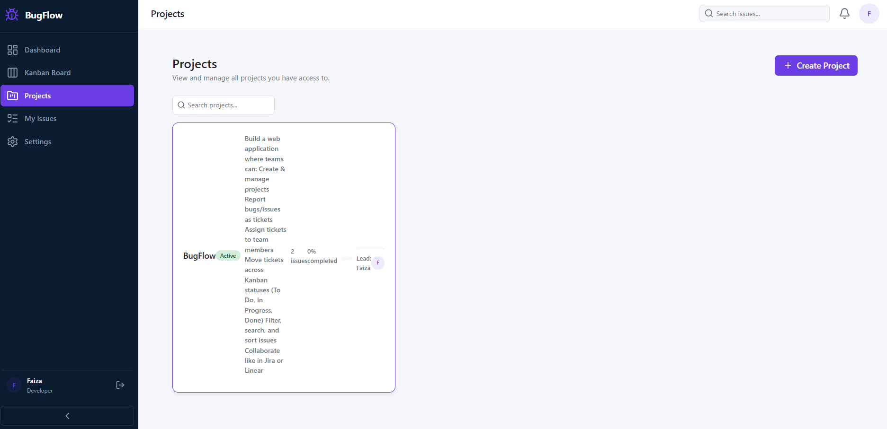
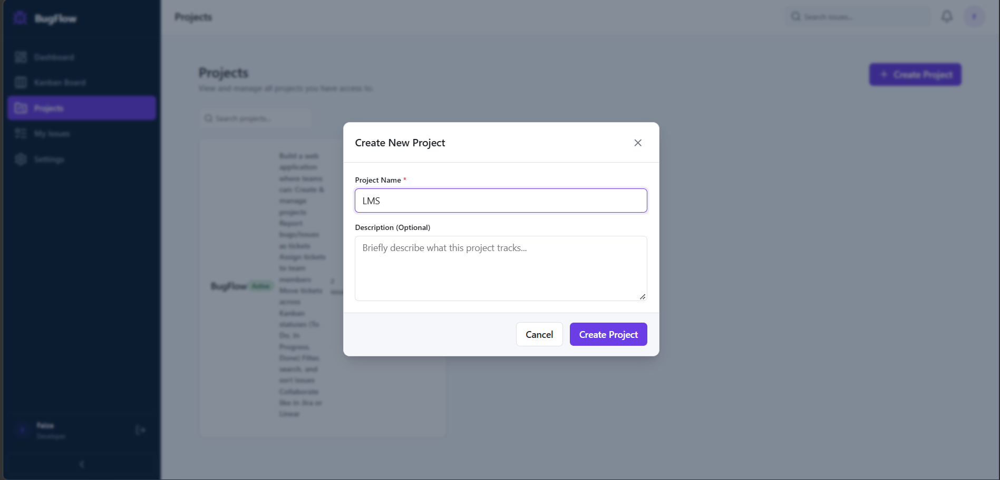
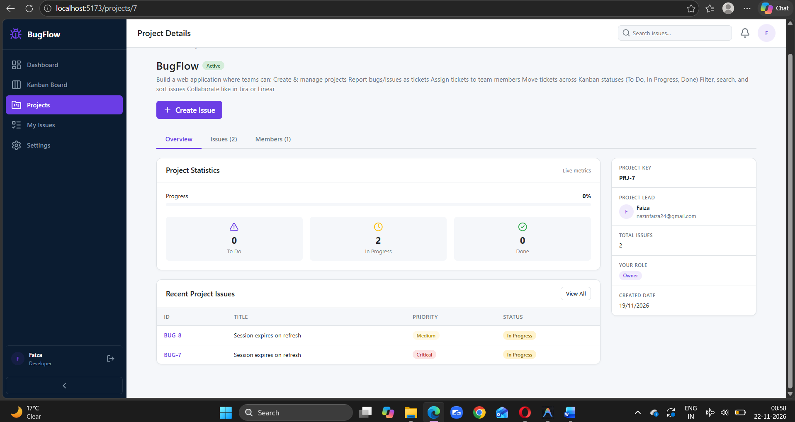
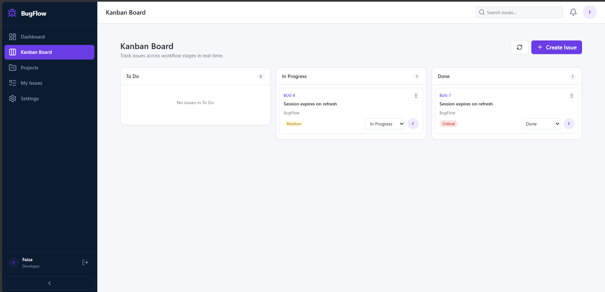
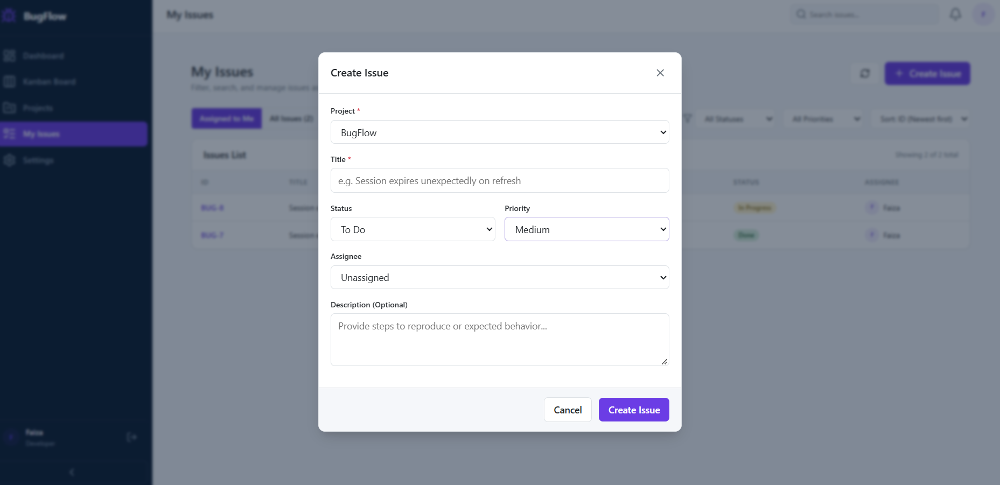
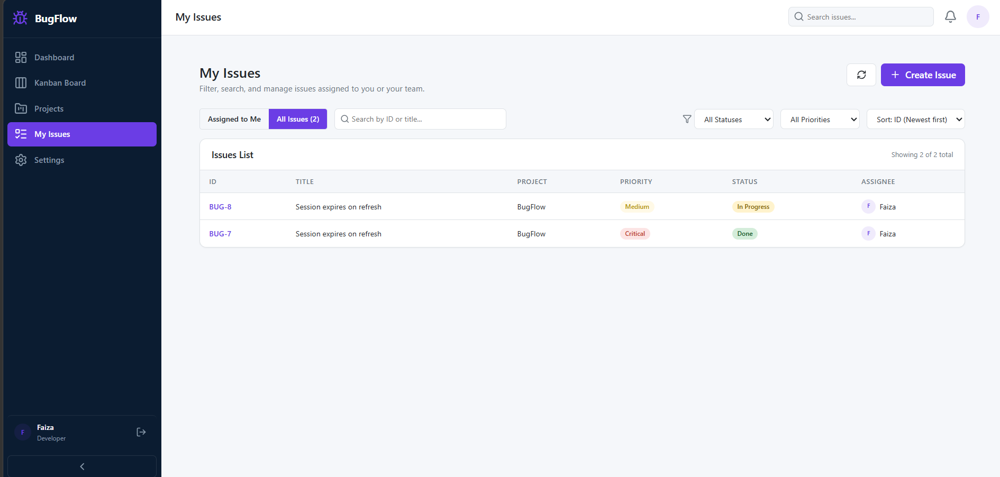
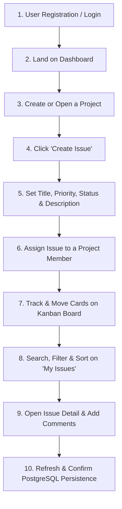
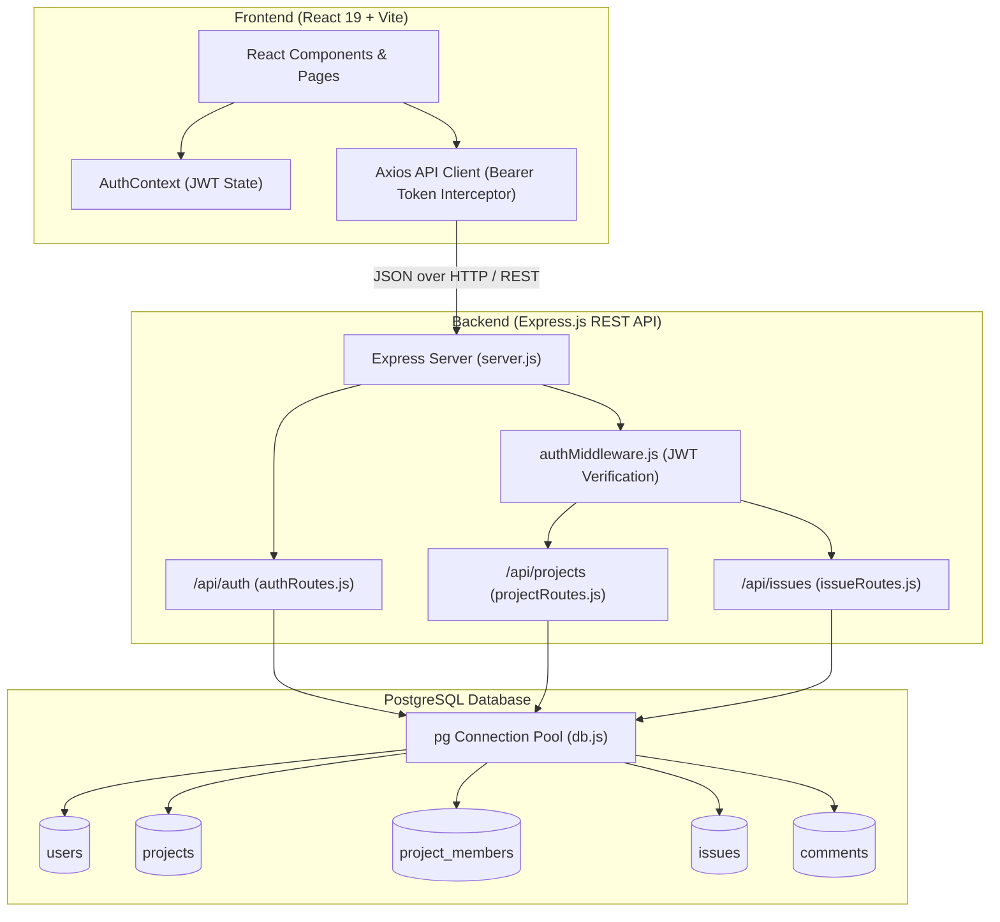

# BugFlow – Issue Tracking and Project Management System

BugFlow is a full-stack, modern issue tracking and project management web application built for engineering teams and developers. Inspired by platforms such as Jira and Linear, BugFlow consolidates project governance, bug tracking, workflow visualization via interactive Kanban boards, and collaborative issue discussions into a unified, secure platform.

---

## Table of Contents

- [1. Project Overview](#1-project-overview)
- [2. Introduction](#2-introduction)
- [3. Research and Problem Statement](#3-research-and-problem-statement)
- [4. Technology Stack and Reasons for Selection](#4-technology-stack-and-reasons-for-selection)
- [5. Key Features](#5-key-features)
- [6. Use Cases](#6-use-cases)
- [7. Complete Application Walkthrough with Screenshots](#7-complete-application-walkthrough-with-screenshots)
- [8. Application Workflow](#8-application-workflow)
- [9. Project Architecture](#9-project-architecture)
- [10. Installation and Setup (Windows & PowerShell)](#10-installation-and-setup-windows--powershell)
- [11. Security and Validation](#11-security-and-validation)
- [12. Testing & Quality Verification](#12-testing--quality-verification)
- [13. Limitations and Future Scope](#13-limitations-and-future-scope)
- [14. Conclusion](#14-conclusion)
- [15. Author and Repository](#15-author-and-repository)

---

## 1. Project Overview

### Project Title
**BugFlow – Issue Tracking and Project Management System**

### Problem Solved
During software development, task assignments, bug reports, and change requests are frequently scattered across email threads, chat channels, and ad-hoc spreadsheets. This fragmentation leads to lost bug reports, unclear ownership, missed release deadlines, and lack of visibility into delivery bottlenecks. BugFlow provides a centralized relational database and a responsive user interface that ensures every bug and development task is cataloged, prioritized, assigned, and tracked through completion.

### Main Objectives
- **Centralize Issue Lifecycle:** Deliver an end-to-end bug tracking workflow with defined stages (`To Do`, `In Progress`, `Done`).
- **Enforce Access Control & Data Integrity:** Protect project and issue records using JSON Web Token (JWT) authentication, password hashing, and project membership authorization.
- **Provide Visual Workflow Management:** Offer an interactive, drag-and-drop Kanban board for immediate status visibility.
- **Support Team Collaboration:** Enable contextual issue comments with user attribution and timestamp tracking.

### Intended Users
- **Software Engineers & Developers:** To log bugs, update resolution states, and discuss technical details.
- **Project Leads & Scrum Masters:** To create projects, assign issues to authorized team members, and monitor progress metrics.
- **Academic & Capstone Development Teams:** To coordinate milestone deliverables with professional-grade issue tracking.

---

## 2. Introduction

BugFlow helps software teams eliminate confusion by centralizing task and defect management into a structured web application. 

Through BugFlow, users can:
- **Organize Projects:** Partition issues into dedicated projects with designated leads and member rosters.
- **Create and Track Issues:** Record bugs with detailed descriptions, priority rankings (`Low`, `Medium`, `High`, `Critical`), and assignees.
- **Visualize Work Progress:** Shift tasks between workflow stages on an interactive Kanban board with instant visual feedback and server synchronization.
- **Collaborate with Context:** Leave timestamped comments on issues to preserve technical findings, pull request links, or verification steps.
- **Filter and Search:** Query issues across multiple criteria—such as status, priority, title keyword, or assignment status ("Assigned to Me").

---

## 3. Research and Problem Statement

### The Problem of Manual Tracking
Managing software defects and feature requests without a dedicated system introduces critical points of failure:
- **Loss of Task Ownership:** Bugs documented in spreadsheets or messaging apps lack accountable assignees, resulting in unassigned or duplicated work.
- **Lack of Priority Alignment:** Team members often cannot distinguish critical production blockers from low-priority cosmetic defects.
- **Zero Visibility into Velocity:** Project stakeholders lack real-time visibility into the proportion of issues completed versus those pending.
- **Broken Audit Trails:** Without dedicated comment threads, historical context on why a bug was resolved or deferred is lost.

### Existing Industry Solutions
Platforms such as **Atlassian Jira** and **Linear** demonstrate the industry standard for agile issue management. They validate the necessity of:
1. Structured state machines (`To Do` → `In Progress` → `Done`).
2. Visual task boards (Kanban / Scrum).
3. Role-based scoping where team members access only projects they participate in.

### BugFlow's Implemented Approach
BugFlow implements a focused, lightweight alternative tailored for clean deployments:
- Unlike heavyweight enterprise tools that require extensive XML/JQL setup, BugFlow offers a straightforward relational schema built directly on PostgreSQL.
- State transitions are strictly constrained at both the API and database levels using PostgreSQL `CHECK` constraints.
- Issues can only be assigned to verified members of that specific project, preventing cross-project assignment bugs.

#### Conceptual Comparison

| Dimension | Manual Tracking (Spreadsheets / Chat) | Enterprise Tools (Jira / Linear) | BugFlow Implemented Approach |
| :--- | :--- | :--- | :--- |
| **Data Integrity** | Prone to accidental overwrites; no relational foreign keys | Highly configurable database engines | Enforced via PostgreSQL relational foreign keys and `CHECK` constraints |
| **Authentication** | Shared links, minimal access control | SSO, SAML, complex IAM policies | Stateless JWT Bearer tokens with `bcryptjs` password hashing |
| **Workflow Visualization**| Static text or color-coded cells | Multi-tiered agile boards | Drag-and-drop Kanban board with optimistic UI updates |
| **Setup Overhead** | Minimal initial setup; unmanageable at scale | Heavy configuration and licensing costs | Fast setup via a clean Node/React stack and a single SQL schema script |

---

## 4. Technology Stack and Reasons for Selection

Every technology listed below was verified directly from the project's root, `frontend/package.json`, `backend/package.json`, and database configuration files.

| Technology | Purpose in BugFlow | Reason for Choosing It |
| :--- | :--- | :--- |
| **React.js 19** | Frontend UI Component Library | Component-based architecture enables clean separation between reusable layouts, pages, modals, and dynamic data tables. |
| **Vite 8** | Frontend Build Tool & Dev Server | Offers sub-second Hot Module Replacement (HMR) and optimized Rollup-based production bundling. |
| **React Router DOM v7** | Client-Side Routing | Provides declarative route definition, route parameters (`/issues/:id`, `/projects/:id`), and private route guards. |
| **Axios** | HTTP Client | Centralized instance with automatic request interceptors that attach stored JWT tokens to every outgoing API call. |
| **Lucide React** | UI Iconography | Lightweight, accessible SVG icons consistent with modern SaaS interfaces. |
| **Plain CSS** | Application Styling | Implements a cohesive design system using CSS custom properties (`var(--color-primary)`, etc.) without heavyweight utility frameworks. |
| **Node.js** | Backend Runtime | Non-blocking, event-driven JavaScript runtime allowing shared syntax patterns across frontend and backend. |
| **Express.js 5** | Backend REST API Framework | Minimalist routing architecture suited for building clean RESTful JSON endpoints. |
| **PostgreSQL** | Relational Database Management System | ACID compliance, strong foreign key constraints (`ON DELETE CASCADE`), and column-level `CHECK` constraints prevent corrupted issue states. |
| **pg (`node-postgres`)** | PostgreSQL Connection Pool | Efficient connection reuse and parameterized query support to prevent SQL injection vulnerabilities. |
| **JSON Web Tokens (`jsonwebtoken`)** | Stateless Authentication | Cryptographically signed Bearer tokens allow secure user identification across distributed HTTP requests without server session state. |
| **`bcryptjs`** | Password Encryption | Industry-standard adaptive salt hashing (12 rounds) prevents plain-text credential leaks. |
| **Helmet** | HTTP Security Headers | Secures Express apps by setting headers for XSS protection, MIME sniffing prevention, and clickjacking protection. |
| **CORS** | Cross-Origin Resource Sharing | Restricts API access to authorized frontend origins in local development and production. |

---

## 5. Key Features

- **Secure User Registration & Authentication:** Validated account creation with 12-round salted `bcryptjs` hashing and 1-hour signed JWT tokens.
- **Client-Side Route Protection:** Unauthenticated requests automatically redirect to `/login`; authenticated users are redirected away from auth pages via `ProtectedRoute` and `PublicRoute`.
- **Project Governance:** Create projects with automatic owner registration in `project_members`. Projects calculate live completion percentages based on closed issues.
- **Project Detail Backlog:** Tabbed interface displaying Project Overview (statistics, lead details), Issues Backlog, and Team Members.
- **Issue Creation Modal:** Global and contextual modal that validates titles (2–200 characters), loads project lists dynamically, and populates assignees strictly from project members.
- **Kanban Board:** Three-column board (`To Do`, `In Progress`, `Done`) featuring native drag-and-drop and fallback dropdown selectors. Implements optimistic UI updates with automatic server rollback on failure.
- **My Issues Filtering & Search:** Filter by scope ("Assigned to Me" vs "All Issues"), text search by title or numeric ID, status filter, priority filter, and multi-field sorting.
- **Issue Details View:** Dedicated page for individual issues (`/issues/:id` or `/issues/BUG-1`) supporting real-time status and priority edits with instant database persistence.
- **Interactive Comments Thread:** Live activity thread displaying author name, avatar initials, formatted timestamps, and comment content, complete with duplicate submission prevention.
- **Executive Dashboard:** Live metrics calculating Total Issues, Open / To Do, In Progress, and Resolved Issues, paired with a Recent Issues table and active Project list.
- **Responsive Layout:** Dark navy collapsible sidebar, responsive top bar with active route title, and mobile navigation drawer.

---

## 6. Use Cases

### 1. Agile Software Development Teams
Development teams can decompose features into discrete bug and task cards. Developers check the Kanban board daily to claim tasks from `To Do`, transition them to `In Progress` during implementation, and close them as `Done` once verified by pull request.

### 2. Team Task Allocation & Ownership
Project managers can open the Project Detail view, create issues, and assign them directly to team members enrolled in that project. This prevents orphaned tasks and clarifies accountability.

### 3. Defect Triage & Priority Management
During QA testing, testers mark critical issues with the `Critical` or `High` priority badges. Engineers sort the "My Issues" page by priority to tackle critical show-stoppers before routine maintenance items.

### 4. Technical Collaboration via Issue Comments
Engineers use the issue comment thread to document root cause analyses, link relevant Git commits, or detail staging environment reproduction steps.

### 5. Academic & Capstone Software Engineering
Student teams and interns can track deliverables across multi-week milestones, demonstrating clean project management and code hygiene for evaluation.

---

## 7. Complete Application Walkthrough with Screenshots

> [!NOTE]
> Screenshots are organized in the chronological order a user navigates through BugFlow.
> Store the screenshots in the repository directory: **`docs/screenshots/`** using the exact relative paths specified below.

### 1. Sign In Page

- **Path:** `docs/screenshots/01-login.png`
- **Description:** Clean SaaS authentication card with email and password inputs, show/hide password toggle, validation banners, and a link to account creation.

### 2. Registration Page

- **Path:** `docs/screenshots/02-register.png`
- **Description:** Registration interface capturing Full Name, Email, Password, and Password Confirmation with client-side password matching validation.

### 3. Application Dashboard

- **Path:** `docs/screenshots/03-dashboard.png`
- **Description:** Central workspace overview displaying live statistic counters (Total Issues, Open, In Progress, Resolved), Recent Issues table with status badges, and project summary cards.

### 4. Projects Directory

- **Path:** `docs/screenshots/04-projects.png`
- **Description:** Card-based listing of all projects the user is authorized to access, showing owner details, issue counts, and visual completion progress bars.

### 5. Create Project Modal

- **Path:** `docs/screenshots/05-create-project-modal.png`
- **Description:** Modal form prompting for Project Name (2–100 characters) and Description. Upon submission, creates the project and assigns the creator as owner in PostgreSQL.

### 6. Project Detail & Backlog

- **Path:** `docs/screenshots/06-project-details.png`
- **Description:** Multi-tab view showing Project Overview metrics, the complete project issue table, and the list of enrolled project members.

### 7. Interactive Kanban Board

- **Path:** `docs/screenshots/07-kanban-board.png`
- **Description:** Workflow board dividing tasks into `To Do`, `In Progress`, and `Done` columns with drag-and-drop capability and inline status change dropdowns.

### 8. Create Issue Modal

- **Path:** `docs/screenshots/08-create-issue-modal.png`
- **Description:** Issue creation dialog with Project selector, Title, Priority dropdown, Status selector, Member Assignee dropdown, and Markdown-compatible Description textarea.

### 9. Issue Details View

- **Path:** `docs/screenshots/09-issue-details.png`
- **Description:** Full-page view of an individual issue showing metadata, editable Status and Priority dropdowns, reporter info, and full description.

---

## 8. Application Workflow

The step-by-step end-to-end user journey is implemented as follows:



1. **Register or Log In:** Users create an account or sign in at `/login`. The backend returns a signed JWT stored in client storage.
2. **Access the Dashboard:** The authenticated user is routed to `/`, displaying live metrics calculated from database queries.
3. **View or Create a Project:** Navigate to `/projects`. The user can create a new project, automatically becoming its owner.
4. **Create an Issue:** Click "Create Issue" from the TopBar, Dashboard, Project Detail, or Kanban page.
5. **Configure Issue Details:** Provide a title (minimum 2 characters), optional description, priority rating, and status.
6. **Assign to Member:** Select an assignee from the project's authorized members list.
7. **Manage Workflow on Kanban:** Navigate to `/kanban`. Drag cards between columns or adjust the quick dropdown to persist changes to the database.
8. **Filter Issues:** Navigate to `/issues` to isolate tasks assigned specifically to the logged-in user or search for specific issue titles.
9. **Collaborate via Comments:** Click any issue to view `/issues/:id`. Post a comment to discuss technical implementation.
10. **Verify Persistence:** Reload the page or sign in from an incognito session; all project, issue, and comment states reload intact from PostgreSQL.

---

## 9. Project Architecture

BugFlow follows a decoupled client-server architecture. The React single-page application (SPA) communicates with the Node.js/Express REST API through Axios HTTP calls, and Express communicates with PostgreSQL via connection pooling.

### Architecture Diagram



### Request & Data Flow
1. **Request Interception:** When a user triggers an action (e.g., updating an issue status), the frontend Axios client injects `Authorization: Bearer <token>` into the HTTP request headers.
2. **Token Verification:** `authMiddleware.js` intercepts protected requests, verifies the JWT signature against `JWT_SECRET`, and attaches `req.user = { id, role }` to the request.
3. **Authorization & Query Execution:** The route handler checks whether `req.user.id` is the owner or an enrolled member of the associated project.
4. **Parameterized SQL:** The query is dispatched to PostgreSQL using `$1, $2` parameters via `pg.Pool`, guaranteeing safety against SQL injection.
5. **Response Delivery:** PostgreSQL returns the updated record; Express packages it into `{ success: true, issue }` with standard HTTP status codes (`200`, `201`, `400`, `401`, `403`, `404`).

---

## 10. Installation and Setup (Windows & PowerShell)

Follow these step-by-step instructions to set up and run BugFlow locally on Windows using PowerShell.

### Prerequisites
- **Node.js:** v18.x or newer ([Download Node.js](https://nodejs.org/))
- **npm:** v9.x or newer (bundled with Node.js)
- **PostgreSQL:** v14.x or newer ([Download PostgreSQL](https://www.postgresql.org/download/windows/))
- **Git:** ([Download Git](https://git-scm.com/))

---

### Step 1: Clone the Repository
Open PowerShell and clone the project:
```powershell
git clone <your-repository-url>
cd BugFlow
```

---

### Step 2: Set Up the PostgreSQL Database
1. Launch PowerShell and log into PostgreSQL with the `psql` command-line tool:
   ```powershell
   psql -U postgres
   ```
2. Create the `BugFlow` database:
   ```sql
   CREATE DATABASE "BugFlow";
   \q
   ```
3. Execute the database schema script ([backend/schema.sql](file:///c:/Users/nazir/Documents/BugFlow/backend/schema.sql)) to create all required tables and constraints:
   ```powershell
   psql -U postgres -d BugFlow -f backend/schema.sql
   ```
   *(Alternatively, copy and paste the contents of `backend/schema.sql` into pgAdmin or your preferred SQL query editor).*

---

### Step 3: Configure and Start the Backend
1. In PowerShell, navigate into the `backend` folder:
   ```powershell
   cd backend
   ```
2. Install dependencies:
   ```powershell
   npm install
   ```
3. Create your local environment configuration file from the template:
   ```powershell
   Copy-Item .env.example .env
   ```
4. Open `backend/.env` in your code editor and provide your actual PostgreSQL password and a secure JWT secret:
   ```env
   PORT=5000
   DB_HOST=localhost
   DB_PORT=5432
   DB_NAME=BugFlow
   DB_USER=postgres
   DB_PASSWORD=your_actual_postgres_password
   JWT_SECRET=your_super_secret_random_key_here
   ```
5. Start the backend server:
   ```powershell
   npm start
   ```
   *Expected output: `BugFlow API running on port 5000`.*
   *Verify database connectivity in your browser: `http://localhost:5000/api/health/db`.*

---

### Step 4: Configure and Start the Frontend
1. Open a **new** PowerShell window and navigate into the `frontend` folder:
   ```powershell
   cd c:\Users\nazir\Documents\BugFlow\frontend
   ```
2. Install dependencies:
   ```powershell
   npm install
   ```
3. Create the frontend environment configuration file:
   ```powershell
   Copy-Item .env.example .env
   ```
   *(Ensure `VITE_API_BASE_URL=http://localhost:5000` is present in `frontend/.env`).*
4. Start the Vite development server:
   ```powershell
   npm run dev
   ```
   *Expected output: `VITE ready in ... ms -> Local: http://localhost:5173/`.*
5. Open your browser and navigate to **`http://localhost:5173/`**.

---

## 11. Security and Validation

BugFlow implements defensive programming practices across authentication, data authorization, and input validation:

1. **Password Encryption:** Passwords are never stored in plaintext. They are hashed using `bcryptjs` with 12 salt rounds before database insertion.
2. **Stateless JWT Authorization:** Tokens carry the verified user ID and role, signed with an HMAC SHA-256 secret. Handlers extract identity from `req.user.id`, never from untrusted request bodies.
3. **Project Membership Verification:** Endpoints modifying or retrieving issues (`POST /api/issues`, `PATCH /api/issues/:id`, `GET /api/issues/:id/comments`) query `project_members` to verify caller authorization, returning `403 Forbidden` for cross-tenant access.
4. **Assignee Boundary Checks:** The API explicitly checks that any user assigned to an issue is an authorized member of that specific project.
5. **SQL Injection Defense:** All queries to PostgreSQL use parameterized queries (`$1, $2, ...`) via `node-postgres`.
6. **Database Integrity Constraints:**
   - Status restricted to `'To Do'`, `'In Progress'`, `'Done'`.
   - Priority restricted to `'Low'`, `'Medium'`, `'High'`, `'Critical'`.
   - Cascade deletions on projects and issues ensure no orphaned comments or memberships remain.
7. **HTTP Security Headers & CORS:** Uses `helmet` to set secure HTTP headers and restricts cross-origin communication with `cors`.

> [!NOTE]
> *Security Transparency:* In this development configuration, JWT tokens are stored in browser `localStorage`. In high-security production deployments, tokens should be transitioned to `HttpOnly`, `SameSite=Strict` cookies, and rate-limiting middleware (such as `express-rate-limit`) should be added to the auth routes.

---

## 12. Testing & Quality Verification

### Automated Integration Testing
BugFlow was verified with dedicated automated Node.js integration test suites executed against the live PostgreSQL database:
- **Authentication Suite:** Validates successful registration, duplicate email rejection (`409 Conflict`), password hashing, and token generation on login.
- **Projects Suite:** Validates project creation, automatic owner assignment, member listing, and `403` rejection when uninvited users query private projects.
- **Issues & Kanban Suite:** Validates issue creation, status transitions, invalid status rejection (`400 Bad Request`), and `404` handling for invalid issue IDs.
- **Comments Suite:** Validates chronological retrieval, non-empty content validation, and unauthorized comment prevention.

### Build and Code Quality
- **Production Build:** Verified with Vite (`npm run build`). Successfully produces optimized production bundles (`dist/`).
- **Code Linting:** Verified with Oxlint across all 28 frontend source files with 0 warnings and 0 errors.

---

## 13. Limitations and Future Scope

To maintain engineering transparency, the table below distinguishes implemented features from planned future enhancements:

| Feature Area | Current Implementation | Future Scope |
| :--- | :--- | :--- |
| **Notifications** | Static indicator UI in TopBar | Real-time WebSocket or email notifications on issue assignment and status changes |
| **Team Management** | Owner membership assigned on project creation | In-app invite system allowing project leads to invite members via email |
| **Rich Text & Attachments** | Plaintext descriptions and comments | Markdown editor, file attachment uploads (PDFs, screenshots) stored on S3/Cloud Storage |
| **Reporting & Metrics** | Live dashboard counters and progress bars | Sprint burndown charts, velocity tracking, and CSV/PDF export capabilities |
| **Role-Based Access** | Project owner vs member distinction | Granular permissions (e.g., custom roles: Viewer, QA Tester, Lead Developer) |

---

## 14. Conclusion

BugFlow demonstrates the implementation of a full-stack, enterprise-style issue tracking and project management system. By combining React 19's component paradigm, Express.js's lightweight routing, and PostgreSQL's relational data integrity, BugFlow delivers an intuitive user experience backed by dependable data structures.

Developing BugFlow provided hands-on experience in:
- Architecting decoupled monorepo full-stack web applications.
- Structuring strict relational schemas with composite primary keys and check constraints.
- Managing client-side global state, optimistic UI transitions, and server-side authorization boundaries.

---

## 15. Author and Repository

- **Project:** BugFlow – Issue Tracking and Project Management System
- **Repository Branch:** `master`
- **License:** [ISC License](file:///c:/Users/nazir/Documents/BugFlow/backend/package.json)
